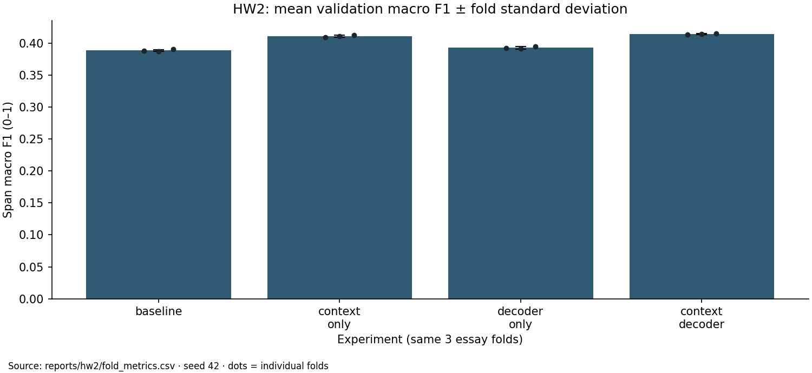
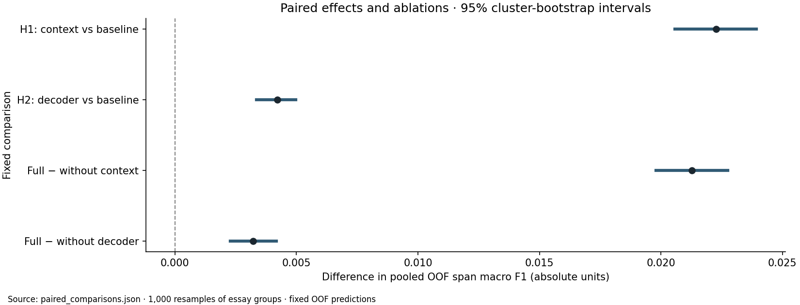
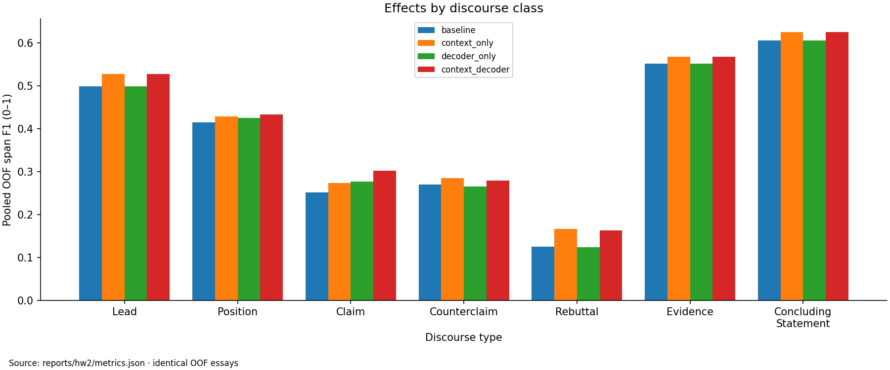
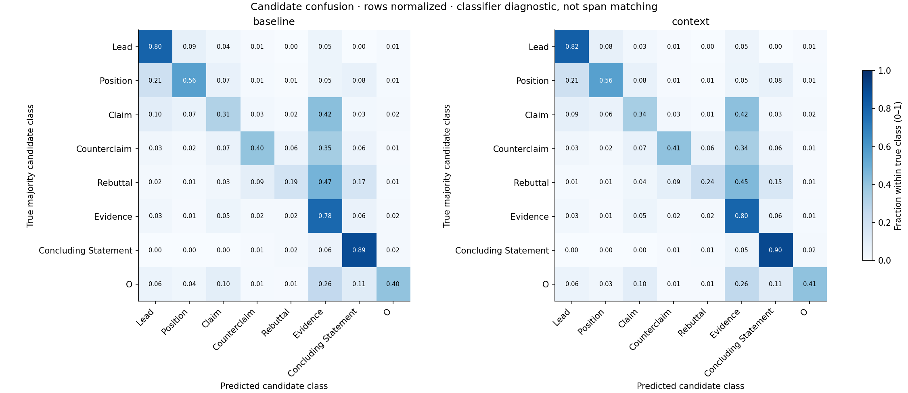

# ДЗ2. Feedback Prize: улучшения, трекинг и абляции

Продолжение baseline из ДЗ1 на тех же 15 594 эссе и 144 293 gold-фрагментах. Выбранная по среднему validation macro F1 конфигурация — **context_decoder**: **0.4138 ± 0.0008** по трём фолдам.

## 1. Два изменения и гипотезы

План и критерии сравнения записаны до просмотра результатов в [HW2_PLAN.md](docs/HW2_PLAN.md). Опорная модель — `lexical_position_balanced` из ДЗ1, переобученная в этом запуске.

**H1 — контекст.** Низкие F1 Claim и Rebuttal в ДЗ1 связываем с отсутствием контекста. Добавлены два отдельных блока TF-IDF предыдущего и следующего кандидата, каждый с весом 0,35. Они используют тот же train-only словарь и IDF, что локальный текст. За границу эссе контекст не переходит; метки соседей не используются. Ожидаются рост macro span F1 и среднего recall Counterclaim/Rebuttal.

**H2 — границы коротких аргументов.** В ДЗ1 Claim в среднем занимает 17,4 слова, Evidence — 77,4. Новый decoder объединяет соседние одинаковые предсказания только для Lead, Evidence и Concluding Statement. Для Claim, Position, Counterclaim и Rebuttal сохраняет кандидатные границы. Ожидаются рост recall Claim и общего macro F1; риск — разделение длинного аргумента на лишние predictions. Список классов и вес контекста заранее фиксированы.

## 2. История экспериментов

| Эксперимент | Контекст | Selective decoder | Seed | Macro F1, mean ± std | OOF macro F1 | Δ к baseline |
| --- | --- | --- | --- | --- | --- | --- |
| baseline | нет | нет | 42 | 0.3883 ± 0.0016 | 0.3883 | +0.0000 |
| context_only | да | нет | 42 | 0.4106 ± 0.0016 | 0.4106 | +0.0223 |
| decoder_only | нет | да | 42 | 0.3925 ± 0.0019 | 0.3925 | +0.0042 |
| context_decoder | да | да | 42 | 0.4138 ± 0.0008 | 0.4138 | +0.0255 |

Артефакты трекинга:

- [experiments.csv](reports/hw2/experiments.csv): гипотеза, компоненты, seed, все три фолда, mean/std, OOF и CI.
- [fold_metrics.csv](reports/hw2/fold_metrics.csv): 12 оценок, размеры train/val, словарь, число признаков, эпохи, время, предупреждения, hashes.
- [events.jsonl](reports/hw2/events.jsonl): события с UTC-временем и идентификатором общего обучения.
- [config_resolved.json](reports/hw2/config_resolved.json) и [run_metadata.json](reports/hw2/run_metadata.json): все параметры, версии, hashes данных, split и кода.

Всего 6 обучений классификатора и 12 оценок: варианты с разными decoder используют одинаковые кандидатные предсказания. Это изолирует вклад decoder и не удваивает обучение. Полный запуск занял 312.4 с. Трекинг локальный, CSV + JSONL, без внешнего сервиса.



Столбцы — среднее по фолдам, полосы — выборочный std (ddof=1), точки — отдельные фолды.

## 3. Абляции и эффекты

| Сравнение | Δ OOF macro F1 | Парный 95% CI | Эффект |
| --- | --- | --- | --- |
| H1: context vs baseline | +0.0223 | [+0.0206; +0.0239] | положительный |
| H2: decoder vs baseline | +0.0042 | [+0.0034; +0.0050] | положительный |
| Full − without context | +0.0213 | [+0.0198; +0.0227] | положительный |
| Full − without decoder | +0.0032 | [+0.0023; +0.0042] | положительный |

Абляция 1: из `context_decoder` удалён контекст → `decoder_only`. Абляция 2: из `context_decoder` удалён selective decoder → `context_only`. В каждой меняется ровно один компонент; остальные параметры, split и предсказания классификатора (для decoder) зафиксированы.

- **H1: context vs baseline:** Компонент повышает macro F1 на этом протоколе.
- **H2: decoder vs baseline:** Компонент повышает macro F1 на этом протоколе.
- **Full − without context:** Компонент повышает macro F1 на этом протоколе.
- **Full − without decoder:** Компонент повышает macro F1 на этом протоколе.

Взаимодействие компонентов (full − context_only − decoder_only + baseline): -0.0010, 95% CI [-0.0017; -0.0003]. Нулевая величина соответствует аддитивности по шкале macro F1; ненулевая показывает зависимость эффекта от второго компонента, но не устанавливает механизм.



Интервалы получены парным ресемплингом одних и тех же групп эссе; вертикальная линия — нулевой эффект.

## 4. Поклассовый анализ и ошибки

| Тип | baseline | context_only | decoder_only | context_decoder |
| --- | --- | --- | --- | --- |
| Lead | 0.4992 | 0.5273 | 0.4992 | 0.5273 |
| Position | 0.4150 | 0.4289 | 0.4246 | 0.4331 |
| Claim | 0.2515 | 0.2734 | 0.2770 | 0.3021 |
| Counterclaim | 0.2697 | 0.2851 | 0.2654 | 0.2791 |
| Rebuttal | 0.1251 | 0.1671 | 0.1237 | 0.1626 |
| Evidence | 0.5517 | 0.5672 | 0.5517 | 0.5672 |
| Concluding Statement | 0.6061 | 0.6253 | 0.6061 | 0.6253 |

H1, средний recall Counterclaim/Rebuttal: 0.2434 → 0.2624. H2, recall Claim: 0.1878 → 0.2162. Эти recall-сравнения описательны, отдельные интервалы для них не строились.

| Эксперимент | OOF micro F1 | Candidate macro F1, 8 классов | Предсказанных spans |
| --- | --- | --- | --- |
| baseline | 0.4360 | 0.5193 | 154274 |
| context_only | 0.4544 | 0.5402 | 150304 |
| decoder_only | 0.4402 | 0.5193 | 161380 |
| context_decoder | 0.4584 | 0.5402 | 157917 |

Candidate F1 одинаков для пар с одним классификатором: decoder влияет только на span-метрику. Это также контроль корректности абляции.





Матрицы относятся к классификации кандидатов; они не измеряют ошибки границ.

Срезы по длине эссе (одинаковые группы для всех конфигураций):

| Срез | baseline | context_only | decoder_only | context_decoder |
| --- | --- | --- | --- | --- |
| short_lt250 | 0.3622 | 0.3842 | 0.3704 | 0.3910 |
| medium_250_499 | 0.3926 | 0.4131 | 0.3960 | 0.4162 |
| long_ge500 | 0.3815 | 0.4047 | 0.3846 | 0.4065 |

Состав классов в срезах различается, поэтому длина не считается доказанной причиной различий. Локальные примеры исправленных, новых и сохраняющихся ошибок: `reports/hw2/private/error_examples.md`. Их тексты не включены в архив.

**Что не сработало по отдельным классам:**

| Вариант | Класс | Baseline F1 | Новый F1 | Δ |
| --- | --- | --- | --- | --- |
| decoder_only | Counterclaim | 0.2697 | 0.2654 | -0.0043 |
| decoder_only | Rebuttal | 0.1251 | 0.1237 | -0.0014 |

Ручное правило коротких ролей нельзя считать универсальным: сохранение каждой кандидатной границы может дробить один gold-аргумент. Это согласуется с наблюдаемым ухудшением, но не доказывает его причину. Таблица описательна, поклассовые CI не строились.

## 5. Честность сравнения

- Три одинаковых essay/group-фолда, seed=42. Сверка с локальным split ДЗ1: True. Полный нормализованный дубликат остаётся в одной группе.
- Страты — наличие Counterclaim/Rebuttal × длина эссе. Две составные страты содержат по одному эссе, поэтому sklearn предупреждает о невозможности точного сохранения всех пропорций. Split оставлен прежним ради сравнения; все семь целевых типов присутствуют во всех фолдах. Контрольные агрегаты: [числа классов по фолдам](reports/hw2/fold_class_counts.csv) и [числа страт](reports/hw2/stratum_counts.csv).
- Baseline переобучен, а не взят из таблицы: разница pooled OOF macro F1 с ДЗ1 = 0.0.
- Одинаковые исходные файлы, word-индексы `.split()`, эвристические кандидаты и train-targets. Gold-границы не подаются на inference.
- TF-IDF/IDF, DictVectorizer, class weights и SGD обучаются только на train фолда. На val только transform/predict. Контекст на val строится внутри целого val-эссе и не обращается к train-эссе.
- Preprocessing фиксирован; экспериментальные контекстные блоки и decoder явно обозначены как единственные изменения. Иначе проверка нового компонента была бы невозможна.
- Одна и та же основная span macro F1, та же реализация matching, одни гиперпараметры SGD, без HPO. Совпадение допустимо только при обоих overlap >=0.5; после однозначного matching считаются TP/FP/FN и F1 каждого из семи типов, затем среднее.
- Выбор только по среднему validation macro F1. Test/leaderboard не участвуют. Полное обучение после выбора служит только inference.
- 1000 парных cluster-bootstrap повторов по группам нормализованных эссе, seed=42; интервалы pooled OOF F1 и разностей — перцентили 2,5/97,5. Mean/std относятся к фолдам, CI — к ресемплингу OOF-групп.

Ограничения: оценки разных фолдов используют пересекающиеся train-части; bootstrap не учитывает переобучение и selection bias. Гипотезы опираются на уже изученную CV из ДЗ1. Эти интервалы условны относительно протокола, а не являются независимой итоговой оценкой. Author/prompt-ID отсутствуют, near-duplicates полностью не контролируются. Положительный CI не доказывает перенос на новые темы.

## 6. Выводы

- **context_only:** гипотеза о росте macro F1 поддержана; Δ=+0.0223, CI [+0.0206; +0.0239].
- **decoder_only:** гипотеза о росте macro F1 поддержана; Δ=+0.0042, CI [+0.0034; +0.0050].
- **Выбор:** `context_decoder` по среднему validation macro F1, без перенастройки после просмотра результатов.
- Контекст может помогать за счёт соседних лексических маркеров, но причинный механизм этими экспериментами не установлен. Избирательное объединение меняет компромисс между пропущенными и лишними spans: короткие роли могут выиграть в recall, длинные — потерять из-за дробления.
- Эффекты с CI, включающим ноль, считаются неразличимыми на этом split. Устойчивость к новым seed и повторному обучению отдельно не проверена. Проверенные изменения могут давать общий прирост, сохраняя неудачные поклассовые эффекты из раздела 4.
- Следующий тест: отдельная обучаемая модель границы между кандидатами вместо ручного списка объединяемых типов. Сначала фиксируется протокол независимой оценки; ещё один подбор списка классов по этой CV не планируется.

## 7. Запуск и артефакты

Python 3.9–3.12, CPU, зависимости из `requirements.txt`. Папка `feedback-prize-2021/` располагается в корне проекта.

```bash
python3 -m venv .venv
source .venv/bin/activate
python -m pip install -r requirements.txt
bash scripts/run_hw2.sh
```

Отдельные этапы:

```bash
python3 -m unittest discover -s tests -v
python3 -m src.hw2_train --config configs/hw2.json
python3 -m src.hw2_report
python3 -m src.hw2_predict --output submission_hw2.csv
```

Для независимого пересчёта span-метрики можно использовать `src.evaluate` с любым `reports/hw2/predictions/*_oof.csv`. OOF-predictions CSV, split, checkpoint и примеры с текстами сохраняются локально. Сдаваемые агрегированные метрики и конфиги лежат в `reports/hw2/` и `configs/hw2.json`. Ни один файл результатов ДЗ1 запуск не перезаписывает.

## 8. Источники и реализация

[Условия ДЗ2](https://github.com/PikaChuChuMF/RnD-ML-Course-2026-2/blob/main/HW_2/HomeWork_2.md), [определение метрики соревнования](https://www.kaggle.com/competitions/feedback-prize-2021/overview/evaluation), [SGDClassifier 1.6](https://scikit-learn.org/1.6/modules/generated/sklearn.linear_model.SGDClassifier.html), [TF-IDF 1.6](https://scikit-learn.org/1.6/modules/generated/sklearn.feature_extraction.text.TfidfVectorizer.html). Используются код baseline и метрики ДЗ1 и стандартные реализации sklearn. Контекст, selective decoder, факторный план, трекинг и отчёт реализованы для проекта с помощью Codex. Чужие notebooks, внешние данные и готовые веса не использованы.
