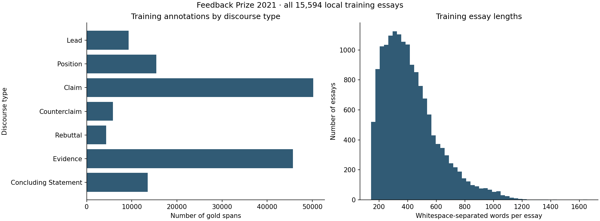
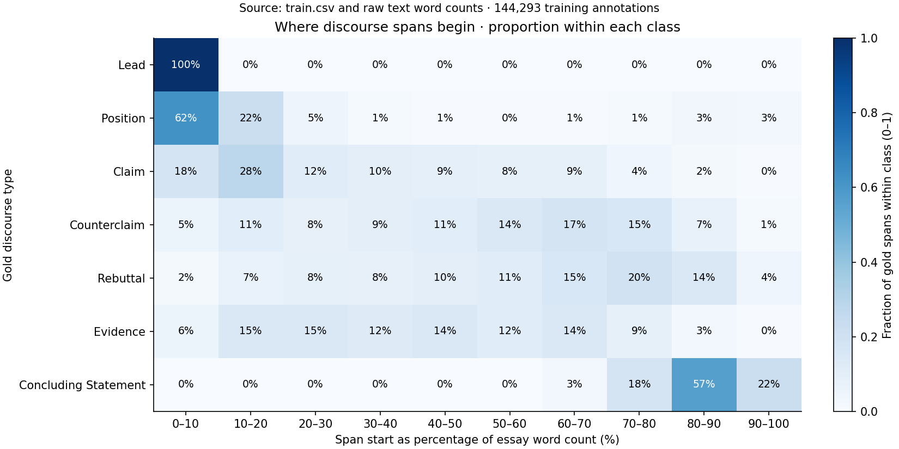
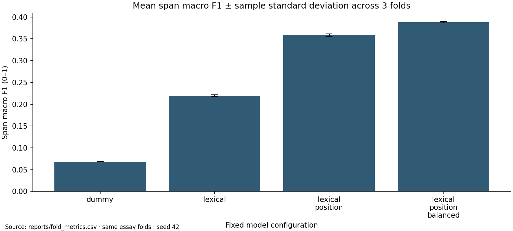

# ДЗ1. Feedback Prize: поиск аргументов в ученических эссе

Воспроизводимое локальное решение соревнования **Feedback Prize — Evaluating Student Writing**.
Вход — целое английское эссе. Выход - индексы слов и тип каждого найденного
риторического фрагмента. Реализованы EDA, простой CPU-baseline, три проверяемые
гипотезы, общая 3-fold валидация без пересечения эссе, bootstrap и анализ ошибок.

Лучший baseline: **TF-IDF + структурные признаки + balanced linear classifier**.
Span macro F1 на трёх фолдах: **0,3883 ± 0,0016**. Pooled OOF macro F1:
**0,3883**, 95% cluster-bootstrap CI **[0,3851; 0,3918]**.
Полный эксперимент занял **316,6 с на CPU** в зафиксированном окружении.

**Результаты:** [измеренный отчёт](reports/RESULTS.md),
[метрики в JSON](reports/metrics.json).

## 1. Постановка задачи

Нужно автоматически сегментировать ученическое эссе и классифицировать
аргументативные и риторические элементы семи типов:

- `Lead` — вступление;
- `Position` — позиция автора;
- `Claim` — тезис;
- `Counterclaim` — противоположный тезис;
- `Rebuttal` — ответ на противоположный тезис;
- `Evidence` — обоснование или пример;
- `Concluding Statement` — заключение.

Такой инструмент может помогать преподавателю находить элементы аргументации
и давать обратную связь о структуре текста. Он не измеряет истинность аргумента,
не выставляет оценку за эссе и не заменяет педагогическую проверку.

На inference доступен только исходный текст эссе. Истинные границы фрагментов,
их число, классы и сведения из `train.csv` недоступны. Задача поэтому включает
**поиск границ**, а не только классификацию уже выделенных эталонных фрагментов.

Основная гипотеза: лексические признаки TF-IDF позволят превзойти контрольный
baseline с наиболее частым классом, поскольку вводные обороты и другие языковые
маркеры связаны с риторической функцией. Дополнительные гипотезы проверяют
структуру эссе и балансировку классов; критерии были записаны
в [плане экспериментов](docs/RESEARCH_PLAN.md) до просмотра метрик.

Ограничения: английские ученические тексты конкретного датасета, неоднозначная
разметка, ошибки пунктуации и сильный дисбаланс. Качество на других возрастах,
языках, авторах и новых темах не установлено. Локальная CV не является
результатом private leaderboard.

## 2. Формализация

- **Объект наблюдения и единица разбиения:** одно полное эссе.
- **X:** исходная строка текста; для каждого автоматически выделенного кандидата
  — его слова, относительная позиция и длина. `id` используется для группировки
  и формата результата, но не как признак.
- **y:** набор `(начальный индекс слова, конечный индекс слова, тип)` для эссе.
  В CSV фрагмент представлен `predictionstring`; индексы начинаются с нуля
  и соответствуют **исходному `text.split()`**, без очистки и удаления слов.
- **Тип задачи:** структурированное предсказание — извлечение сегментов и
  multiclass-классификация каждого сегмента. Внутренняя обучающая задача
  baseline — multiclass-классификация автоматически выделенного кандидата
  в 8 классов: семь типов + `O` (неразмеченная область).
- **Одно выходное предсказание:** одна строка `id,class,predictionstring`.
  Для одного документа возможны несколько строк одного типа.
- **Inference:** тот же алгоритм строит кандидаты непосредственно из `.txt`.
  Никакие `discourse_text`, `discourse_start/end`, `discourse_id`,
  `discourse_type_num` или другие поля разметки не подаются модели.

Исходная разметка иногда назначает одному граничному слову два типа.
Это не меняет формат цели как набора фрагментов. Только для суррогатных
обучающих меток применяется явное разрешение конфликтов (см. §4).

## 3. Данные и EDA

Источник: [данные соревнования](https://www.kaggle.com/competitions/feedback-prize-2021/data).
Локальная папка: `feedback-prize-2021/`.
Никакие дополнительные данные и pretrained-модели не используются.

- Train: **15 594 эссе**, **144 293 размеченных фрагмента**, **6 569 098 слов**.
- Автоматическая сегментация создаёт **339 897 кандидатов**.
- В предоставленной test-папке **5 текстов**; это демонстрационные файлы,
  а не весь закрытый тест соревнования. Их меток нет; качество на них не считается.
- Длина эссе: минимум 144, медиана 384, Q1/Q3 278/520, 95-й перцентиль 796,
  максимум 1656 слов.
- Пропусков во всех восьми столбцах `train.csv` нет; полных дубликатов строк нет.
  Все ID разметки имеют соответствующий `.txt`, лишних train-текстов нет.
- После lowercase и схлопывания whitespace найден **1 дополнительный дубликат
  эссе**; одинаковые тексты объединены в группу для CV.
- **305 458 слов (4,65%)** не покрыты размеченными фрагментами — для них нужен `O`.
- При чтении аннотаций обнаружено **1258 повторных назначений слов**
  (0,019% всех слов), из них **993** с разными классами.
  Недопустимых или выходящих за текст word-индексов нет.
- У **13 719 фрагментов (9,51%)** `discourse_text.strip()` отличается от
  символьного среза по `discourse_start/end`. В просмотренных примерах различается
  завершающая пунктуация. Это диагностика несогласованности представлений,
  а не утверждение, что все эти строки ошибочны. Для обучения и оценки
  используется `predictionstring` и исходный `.txt`.

Частоты фрагментов: Claim — 50 208; Evidence — 45 702; Position — 15 419;
Concluding Statement — 13 505; Lead — 9305; Counterclaim — 5817; Rebuttal — 4337.
Частей Claim примерно в 11,6 раза больше, чем Rebuttal. Evidence в среднем
занимает 77,4 слова, Claim — 17,4: одна и та же эвристика границ не будет
одинаково хороша для разных типов. Подробности: [аудит](reports/data_audit.json)
и [длины фрагментов](reports/span_lengths.csv).



Положение фрагментов различается по типам: **99,9% Lead** начинаются в первых
20% эссе, а **78,9% Concluding Statement** — в последних 20%. Медиана начала
вступления — 0% длины эссе, заключения — 85,4%. Начало измеряется как индекс
первого слова фрагмента, делённый на число слов в исходном эссе.



Каждая строка графика нормирована по числу фрагментов соответствующего класса:
так можно сравнить расположение редких и частых типов. Это описательная EDA
по всей train-выборке; она обосновывает H2, но эффект позиционных признаков
устанавливается сравнением моделей на общей CV. Агрегированные значения
сохранены в [discourse_positions.csv](reports/discourse_positions.csv).

Потенциальный шум: неоднозначность между Position/Claim и
Counterclaim/Rebuttal, частичная разметка, опечатки, неверная пунктуация,
пересечения на границах. Источники leakage: попадание частей одного эссе или
дубликатов в разные фолды, обучение словаря на validation, использование
истинных границ, отбор модели по leaderboard. Первые риски предотвращены
описанным протоколом. Near-duplicates, один автор в разных эссе и общие prompts
полностью не контролируются: необходимых авторских/prompt-ID в данных нет.

## 4. Baseline и preprocessing

Пайплайн: **сырой текст → кандидаты → TF-IDF → линейный классификатор →
объединение соседних кандидатов → фрагменты с word-индексами**.

1. Выделяются исходные whitespace-слова (`\S+` эквивалентно индексам `.split()`).
   Кандидат заканчивается после слова с `.`, `!`, `?` перед необязательной
   закрывающей кавычкой/скобкой либо перед переводом строки. Последний остаток
   тоже сохраняется. Слова не теряются и не переставляются; нормализация текста
   для дубликатов не меняет данные для word-индексов.
2. Для **обучения** каждому слову присваивается тип по `predictionstring`,
   остальным — `O`. На пересечении побеждает раньше начинающийся фрагмент
   (сортировка по start, end, type). Метка кандидата — наиболее частая метка его
   слов, включая `O`; при равенстве фиксирован порядок `CLASSES + [O]`.
   Истинные аннотации для span-оценки не изменяются.
3. TF-IDF: lowercase, униграммы и биграммы, `min_df=3`, до 40 000 признаков,
   `sublinear_tf=True`, L2-нормализация, стандартный token pattern sklearn
   (лексические токены от двух символов). Стоп-слова не удаляются: служебные
   конструкции могут быть полезны. Числа, пунктуация и односимвольные слова
   остаются в исходном тексте и нумерации, даже если не становятся TF-IDF-признаками.
4. Линейная модель — `SGDClassifier(loss='log_loss', penalty='l2')`:
   one-vs-rest линейная классификация с логистической функцией потерь,
   `alpha=1e-5`, `max_iter=60`, `tol=1e-3`, `average=True`, seed=42.
   Это не transformer и не ансамбль. Предсказание класса — `argmax`, без
   подбора class-specific thresholds.
5. Структурный вариант добавляет 10 бинов позиции, 6 бинов длины
   (границы 5/10/20/40/80 слов), признаки первого/последнего кандидата,
   относительные начало, конец и длину. `DictVectorizer` обучается на train;
   вес блока фиксирован 0,5. Здесь проверяется совместная польза позиции и длины.
6. Вариант `_balanced` использует `class_weight='balanced'`: веса обратно
   пропорциональны частоте **кандидатных** меток на train соответствующего фолда.
7. Соседние кандидаты одинакового предсказанного типа объединяются внутри одного
   абзаца; `O`, смена класса, документа или абзаца прерывают объединение.
   Минимальная длина фрагмента и дополнительные пороги не настраиваются.

Контроль: `DummyClassifier(strategy='most_frequent')`, обученный на кандидатных
метках train, с теми же кандидатами и декодером. Он показывает, что даёт частотный
приоритет без текстовых признаков. Выбор не случайный: получаем детерминированную
и дешёвую точку отсчёта, с которой сравниваются все улучшения.

Baseline прост, не требует GPU/сети, имеет интерпретируемые линейные признаки
и работает за минуты. Его ограничение — грубые границы и отсутствие контекста
между кандидатами. Полный набор параметров: [конфигурация](configs/baseline.json).

## 5. Протокол оценки и защита от утечек

Основная метрика — **span-level macro F1 по семи типам**, соответствующая
[описанию соревнования](https://www.kaggle.com/competitions/feedback-prize-2021/overview/evaluation).
Accuracy по словам или F1 по заранее известным gold-фрагментам её не заменяют.

Для gold G и prediction P одного эссе и класса рассчитывается пересечение
word-индексов I. Совпадение допустимо, если `|I|/|G| >= 0.5` **и**
`|I|/|P| >= 0.5`. Matching взаимно однозначный: при нескольких вариантах
приоритет задаётся убыванием пары `(max(overlaps), min(overlaps))`, затем
исходными индексами как детерминированным разрешением равенства.
Несопоставленные predictions — FP, gold — FN. По каждому классу
`F1 = 2TP/(2TP+FP+FN)`, затем берётся среднее семи F1. `O` не оценивается.
Класс с нулевым знаменателем получает F1=0; в полных фолдах представлены все типы.
Реализация написана по определению и проверена на примере Kaggle и граничных
случаях; сопоставление с закрытым scorer-сервером не проводилось.

Используется `StratifiedGroupKFold(n_splits=3, shuffle=True, random_state=42)`
на уровне **целых эссе**. Группа — hash нормализованного текста. Страта —
сочетание наличия Counterclaim, наличия Rebuttal и бина длины <250 / 250–499 /
>=500. Так приблизительно сохраняются редкие типы и длина, а документы и
дубликаты не пересекаются. Это не идеальная многометочная стратификация:
распределение всех семи классов не гарантированно идентично.
Фактическое разбиение сохранено локально в `reports/splits/essay_folds.csv`.

Каждый vectorizer и веса классов обучаются **только на train фолда**.
Кандидаты строятся одинаково на train, validation и test без знания gold-границ.
Во всех сравнениях используются одни и те же фолды. OOF-предсказание каждого
эссе получено моделью, которая это эссе не видела.

Модель выбирается по максимальному **среднему validation span macro F1**
по трём фолдам. Параметры и decoder после просмотра метрик не менялись.
Переобученная на всех train модель сохраняется только для дальнейшего inference;
её train-оценка не выдаётся за validation. Test/leaderboard не участвуют в выборе.

Дополнительные показатели: поклассовые precision/recall/F1, micro F1,
кандидатные macro F1/accuracy и confusion matrix, срезы по длине.
Mean ± std характеризуют три фолда; используется выборочный std (`ddof=1`).
Для pooled OOF macro F1 и парных разностей рассчитаны 1000 cluster-bootstrap
повторов с seed=42; единица ресемплинга — группа нормализованных эссе, 95% CI
по перцентилям 2,5/97,5. Это не усреднение F1 отдельных эссе: сначала суммируются
TP/FP/FN, затем считается macro F1.

**Ограничение оценки:** фолды имеют пересекающиеся обучающие части, а по этим же
CV-результатам выбирается конфигурация. Bootstrap условен относительно split и
предсказаний, не учитывает неопределённость переобучения и selection bias.
Здесь он помогает сравнить фиксированные варианты; для независимой итоговой
оценки нужна nested CV или отдельный закрытый test. Разброс между фолдами
не доказывает устойчивость к другим seed или новым темам.

## 6. Результаты и ошибки

Полные измеренные числа, таблица mean ± std, интервалы, поклассовые метрики,
срезы и графики находятся в [reports/RESULTS.md](reports/RESULTS.md).
Все конфигурации оценены на всей размеченной выборке через OOF.

| Конфигурация | Span macro F1, среднее ± std по 3 фолдам | Pooled OOF macro F1 |
| --- | --- | --- |
| Most-frequent dummy | 0,0680 ± 0,0005 | 0,0680 |
| TF-IDF + linear logistic loss | 0,2196 ± 0,0019 | 0,2196 |
| + позиция и длина | 0,3587 ± 0,0025 | 0,3586 |
| + балансировка классов | **0,3883 ± 0,0016** | **0,3883** |

У выбранной модели micro F1 = 0,4360. По классам: Lead F1=0,4992;
Position=0,4150; Claim=0,2515; Counterclaim=0,2697; Rebuttal=0,1251;
Evidence=0,5517; Concluding Statement=0,6061. Самый слабый тип — Rebuttal,
поэтому высокий recall заключений нельзя трактовать как хорошее качество
всех элементов аргументации.



Типичные ошибки:

1. **Claim ↔ Evidence:** отдельное утверждение содержит фактическую лексику,
   но его роль определяется контекстом. Дополнительно decoder может объединять
   несколько соседних тезисов одного типа в один слишком длинный фрагмент.
   Конкретный OOF-случай: gold Claim на словах 84–116 (33 слова) попал внутрь
   предсказанного Evidence на словах 69–116 (48 слов).
2. **Rebuttal ↔ Counterclaim:** локальная лексика несогласия похожа, а baseline
   не моделирует, является ли фрагмент возражением или ответом на него.
   Конкретный OOF-случай: Rebuttal 219–236 (18 слов) предсказан как часть
   Counterclaim 201–236 (36 слов).
3. **Position ↔ Claim:** глобальная позиция и локальный тезис могут быть
   сформулированы похоже; у модели нет документного ограничения на их роли.
   Конкретный OOF-случай: Position 32–79 (48 слов) заменён Claim 36–66
   (31 слово). Здесь одновременно ошибочны класс и границы.

Примеры с ID, fold, текстом, границами, gold и prediction:
[разбор ошибок](reports/private/error_examples.md), создаваемый `python3 -m src.report`.
Агрегированные [частоты ошибок классов](reports/error_pairs.csv) сохранены отдельно.
Интерпретации ошибок — гипотезы о причинах поведения модели.

## 7. Выводы и следующая итерация

**H1 поддержана:** Δ OOF macro F1 лексики относительно dummy = +0,1517,
парный 95% CI [+0,1490; +0,1544]. **H2 поддержана:** структура даёт +0,1390,
CI [+0,1366; +0,1415]; F1 Lead растёт 0,1891 → 0,5425,
Concluding Statement — 0,1647 → 0,5983. **H3 описательно поддержана:**
средний recall Counterclaim/Rebuttal растёт 0,0496 → 0,2434.
Условие практической полезности выполнено: macro F1 не падает, а растёт
на +0,0297, CI [+0,0269; +0,0324]. При этом micro F1 снижается
0,4551 → 0,4360, F1 Evidence — 0,5922 → 0,5517, precision редких типов
падает. Балансировка меняет компромисс между классами, а не улучшает всё сразу.

На коротких эссе (<250 слов) macro F1=0,3622, на средних — 0,3926,
на длинных (>=500) — 0,3815. Это описательные срезы: классовый состав
различается, поэтому длина не доказана как причина разницы.

Диагностика с истинной доминирующей меткой каждого кандидата и тем же decoder
даёт span macro F1=0,8600. Она недоступна на inference и не является строгой
верхней границей, но разрыв с 0,3883 указывает, что одной ошибкой сегментации
низкое качество модели не объясняется; нужно улучшать и классификацию ролей.

Локальная линейная модель решает полную задачу извлечения. Система остаётся baseline: sentence-эвристика зависит
от пунктуации, объединение теряет границы соседних фрагментов одного типа,
локальный TF-IDF не понимает связи между аргументами.

Разумная следующая гипотеза: **добавление TF-IDF предыдущего и следующего
кандидата с отдельными префиксами признаков повысит средний span recall
Counterclaim/Rebuttal и общий macro F1 при том же decoder**. Для проверки
сначала фиксируются новая конфигурация и критерий положительного парного CI,
используются те же фолды; до итоговых заявлений нужна независимая оценка.
Отдельная абляция должна проверить предсказание границы между соседними
кандидатами вместо безусловного объединения одинаковых классов. Смешивать
изменения контекста и decoder в одном эксперименте не следует.

## 8. Ответы на вопросы

1. **Что предсказывается и почему?** Границы и семь типов риторических
   фрагментов: это исходная задача соревнования и основа структурной обратной
   связи по эссе (§1, §2).
2. **Объект, X, y, inference?** Объект — целое эссе; X — сырой текст,
   y — набор фрагментов с классами; на inference доступны только текст и его
   вычисляемые позиционные признаки (§2).
3. **Метрика и валидация?** Span macro F1 с bidirectional overlap >=0.5;
   3-fold stratified group CV по целым эссе и нормализованным дубликатам,
   fit preprocessing внутри фолда (§5).
4. **Baseline и признаки?** TF-IDF + регуляризованная линейная модель с logistic
   loss, абляции позиции/длины и class weights; кандидаты из исходного текста,
   одинаковый decoder во всех вариантах (§4).
5. **Ошибки, утечки, следующая гипотеза?** Путаются близкие риторические роли,
   теряются границы, особенно при плохой пунктуации. Исключены пересечение
   документов/дубликатов и fit на validation; неконтролируемы авторы и prompts.
   Следующий тест — контекст соседних кандидатов (§3, §6, §7).

## 9. Три исследовательских вопроса

1. Улучшит ли TF-IDF + linear logistic loss span macro F1 относительно
   most-frequent dummy на одинаковых фолдах, с положительным парным 95% CI?
2. Улучшит ли добавление позиции и длины общий span macro F1 и F1
   Lead/Concluding Statement по сравнению с одной лексикой?
3. Поднимет ли inverse-frequency балансировка средний recall
   Counterclaim/Rebuttal без потери macro F1 более 0,01?

Критерии сравнения описаны в [RESEARCH_PLAN.md](docs/RESEARCH_PLAN.md).

## 10. Воспроизведение

Требования: Python **3.9–3.12**, CPU и несколько GB свободной RAM.
Фактическое окружение и длительность запуска записываются в
[reports/environment.json](reports/environment.json). Доступ к сети нужен только
для установки пакетов. GPU не требуется.

Из корня проекта:

```bash
python3 -m venv .venv
source .venv/bin/activate
python -m pip install -r requirements.txt
bash scripts/run_baseline.sh
```

Разместите папку `feedback-prize-2021/` рядом с README. Ожидаются
`train.csv`, `train/*.txt`, `test/*.txt`, `sample_submission.csv`.

Один запуск выполняет проверки, аудит, 12 обучений/оценок (4 конфигурации ×
3 фолда), bootstrap, переобучение выбранной модели, построение отчёта и inference.

Отдельные команды:

```bash
# Проверки критичных частей, без обучения на всём датасете
python3 -m unittest discover -s tests -v

# EDA, CV, bootstrap, итоговая модель
python3 -m src.train --config configs/baseline.json

# Графики и таблицы из сохранённых результатов
python3 -m src.report

# Независимый пересчёт метрики по сохранённым OOF-предсказаниям
python3 -m src.evaluate --predictions reports/predictions/lexical_position_balanced_oof.csv

# Только inference: train.csv не читается
python3 -m src.predict --texts-dir feedback-prize-2021/test --output submission.csv

# Архив с кодом и агрегированными результатами, без данных/моделей/текстов
python3 scripts/package_submission.py
```

В проекте:

```text
configs/baseline.json          фиксированные параметры
src/data.py                   аудит, кандидаты, метки и decoder
src/model.py                  линейные baseline
src/train.py                  CV, bootstrap, выбор и полное обучение
src/metrics.py                span matching и метрики
src/evaluate.py                отдельный скрипт оценки и проверка формата
src/predict.py                 inference из сырых текстов
src/report.py                  агрегированные графики и локальные ошибки
scripts/run_baseline.sh        полный воспроизводимый запуск
scripts/package_submission.py  упаковка сдаваемой части
tests/test_pipeline.py         тесты метрики, split, preprocessing и индексов
reports/                      измеренные результаты
artifacts/baseline.joblib      локальная итоговая модель, исключена из git
```

Для воспроизводимости сохранены конфигурация, seed, разбиение, версии пакетов,
hash `train.csv`, манифеста текстов и исходного кода. Зависимости закреплены
в `requirements.txt`.
