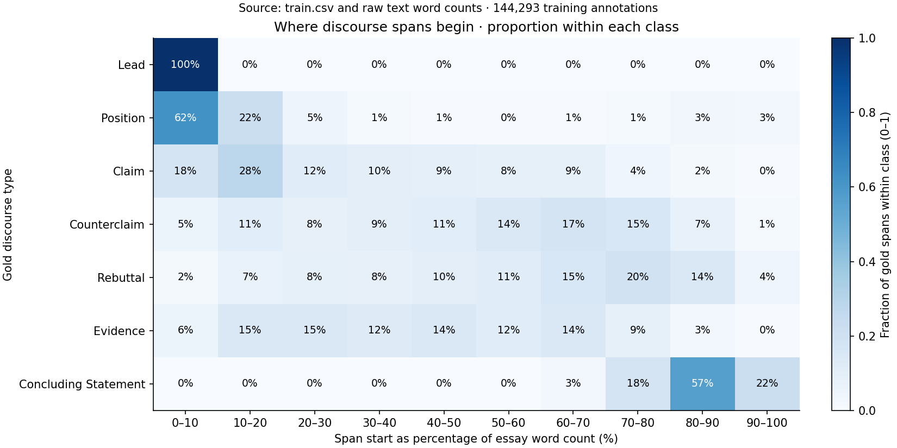
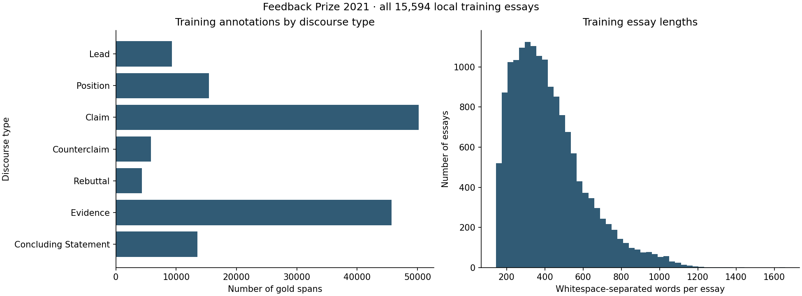
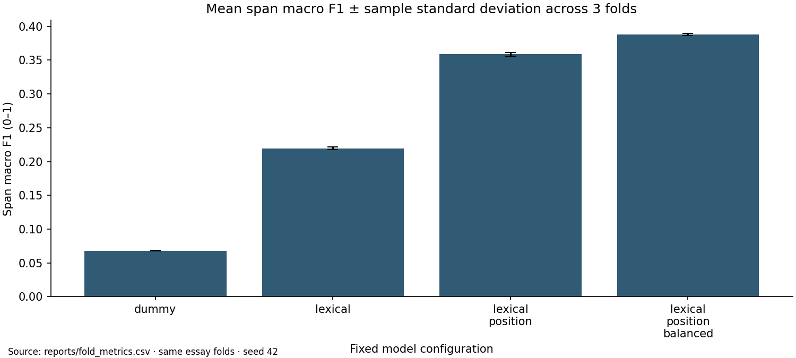
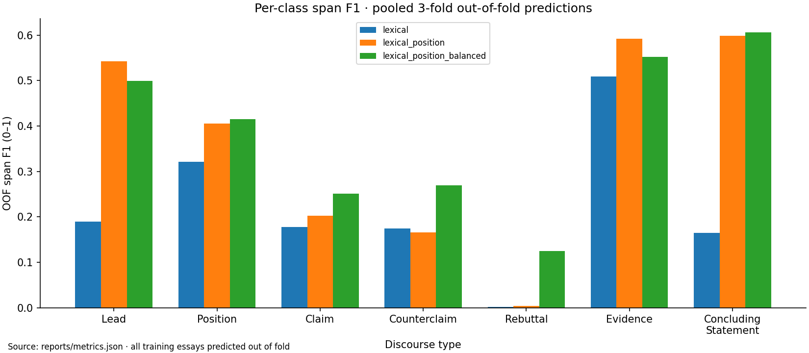
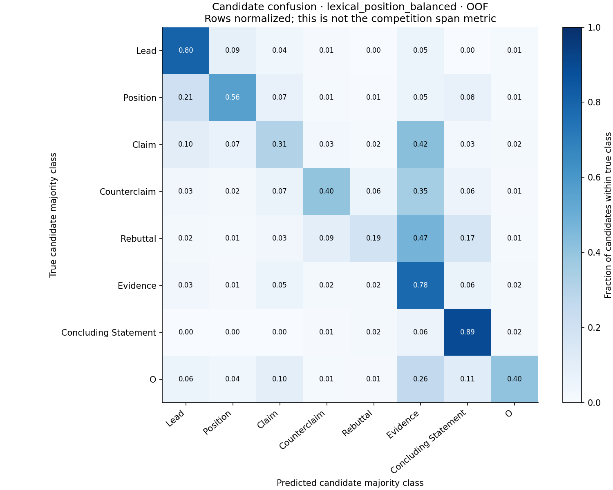

# Измеренные результаты

Все числа получены локальным запуском; без GPU, внешних данных и leaderboard.

| Конфигурация | Span macro F1, mean ± std | Pooled OOF macro F1 | 95% cluster-bootstrap CI OOF | OOF micro F1 | Обучение + оценка 3 фолдов, с |
| --- | --- | --- | --- | --- | --- |
| dummy | 0.0680 ± 0.0005 | 0.0680 | [0.0673; 0.0687] | 0.2727 | 5.3 |
| lexical | 0.2196 ± 0.0019 | 0.2196 | [0.2168; 0.2224] | 0.3387 | 54.5 |
| lexical_position | 0.3587 ± 0.0025 | 0.3586 | [0.3556; 0.3617] | 0.4551 | 66.6 |
| lexical_position_balanced | 0.3883 ± 0.0016 | 0.3883 | [0.3851; 0.3918] | 0.4360 | 73.1 |

Выбор по среднему validation macro F1: **lexical_position_balanced**. Std — выборочный (ddof=1), не standard error. Интервал условен относительно split и выбора конфигураций.

## Проверка трёх гипотез

- `lexical_minus_dummy`: Δ pooled OOF macro F1 = +0.1517; парный 95% CI [+0.1490; +0.1544].
- `lexical_position_minus_lexical`: Δ pooled OOF macro F1 = +0.1390; парный 95% CI [+0.1366; +0.1415].
- `lexical_position_balanced_minus_lexical_position`: Δ pooled OOF macro F1 = +0.0297; парный 95% CI [+0.0269; +0.0324].

H3, средний recall Counterclaim/Rebuttal: 0.0496 → 0.2434; Δ=+0.1938. Это описательное сравнение recall.

## Метрики выбранной модели по классам

| Класс | Precision | Recall | F1 | TP | FP | FN |
| --- | --- | --- | --- | --- | --- | --- |
| Lead | 0.3734 | 0.7528 | 0.4992 | 7005 | 11757 | 2300 |
| Position | 0.4360 | 0.3959 | 0.4150 | 6104 | 7896 | 9315 |
| Claim | 0.3809 | 0.1878 | 0.2515 | 9427 | 15320 | 40781 |
| Counterclaim | 0.2262 | 0.3338 | 0.2697 | 1942 | 6642 | 3875 |
| Rebuttal | 0.1058 | 0.1529 | 0.1251 | 663 | 5601 | 3674 |
| Evidence | 0.4935 | 0.6255 | 0.5517 | 28586 | 29340 | 17116 |
| Concluding Statement | 0.4737 | 0.8415 | 0.6061 | 11364 | 12627 | 2141 |

## Срезы длины эссе

| Длина | Эссе | OOF span macro F1 |
| --- | --- | --- |
| short_lt250 | 2919 | 0.3622 |
| medium_250_499 | 8289 | 0.3926 |
| long_ge500 | 4386 | 0.3815 |

Диагностика кандидатной сегментации: если присвоить каждому кандидату истинный доминирующий класс и применить тот же decoder, span macro F1 = 0.8600. Это использует gold, не является deployable-моделью или строгой верхней границей, и не участвует в выборе модели.

Вторичная метрика выбранной модели: candidate macro F1 (8 классов, включая O) = 0.5193, accuracy = 0.6845. Она оценивает суррогатную задачу на автоматически выделенных кандидатах, а не качество извлечения аргументов.

## Положение аргументов в эссе

Начало gold-фрагмента делится на число исходных whitespace-слов в эссе. Каждый фрагмент учитывается один раз; строки графика нормированы отдельно для каждого класса.

| Класс | Медиана начала, % длины эссе | Начинаются в первых 20%, % фрагментов | Начинаются в последних 20%, % фрагментов |
| --- | --- | --- | --- |
| Lead | 0.0 | 99.9 | 0.0 |
| Position | 6.5 | 84.7 | 6.0 |
| Claim | 22.6 | 45.8 | 2.2 |
| Counterclaim | 54.5 | 16.1 | 8.7 |
| Rebuttal | 62.5 | 8.9 | 18.5 |
| Evidence | 41.4 | 20.8 | 3.4 |
| Concluding Statement | 85.4 | 0.0 | 78.9 |

В первых 20% эссе начинаются 99.9% фрагментов Lead; в последних 20% — 78.9% заключений. Медианы начала: 0.0% и 85.4% длины эссе соответственно. Это объясняет мотивацию H2; эффект признаков проверен отдельной CV-абляцией. Статистика описывает всю train-выборку и не используется для настройки модели.

## Графики

Размеры классов и длины эссе показывают дисбаланс и разную сложность документов.

Сравнение идёт на одинаковых фолдах; ошибки на графике — std между фолдами.

Поклассовый F1 позволяет отделить улучшение частых типов от качества редких.

Матрица относится к кандидатной классификации; ошибки границ оценивает span F1.
